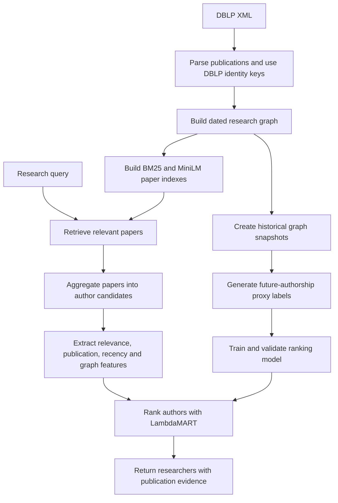

# ScholarGraph — Research Expert Discovery

ScholarGraph is an **AI-powered research expert discovery system** that identifies researchers from public DBLP publication data. It combines a **research collaboration graph**, **hybrid search**, and a **machine learning ranking model** to match research topics with relevant authors. A Next.js interface presents researcher profiles, supporting publications, and collaboration evidence, while a Python API powers search, conversations, and voice interaction.

- **Live frontend:** [scholargraph-one.vercel.app](https://scholargraph-one.vercel.app/)
- **API health:** [34.100.138.196.sslip.io/health](https://34.100.138.196.sslip.io/health)
- **Frontend API health:** [scholargraph-one.vercel.app/api/health](https://scholargraph-one.vercel.app/api/health)

The frontend runs on Vercel and the backend runs in Docker on a Google Cloud Compute Engine VM, behind an HTTPS proxy. On 7 November 2026, both health endpoints reported **265,885 publication records and 332,611 researcher records**, and a `graph neural networks` search through the frontend API returned results. These counts describe the deployed snapshot, not the whole DBLP database. The offline run instructions below support evaluating another DBLP slice.

The backend VM has 2 vCPUs, 8 GB RAM and a 50 GB boot disk. It uses `SCHOLARGRAPH_QUERY_PROVIDER=recorded`, which uses recorded outputs for matching queries and deterministic parsing for unseen or invalid ones. A single search and health check passed; these checks do not establish capacity under concurrent load. Google Cloud compute, disk and networking consume trial credits or incur charges according to the account's billing terms.

### Deploying the local index

The local index is generated data under `data/`, which is excluded from Git and the Docker build. The VM therefore cannot receive it through a code deployment alone. The container normally prepares the bundled sample unless `HIRESENSE_CONFIG` identifies another prepared index. The health counts describe the index actually loaded, not a cached frontend count.

1. On the machine with the desired index, create an archive (allow several GB of free space):

   ```sh
   python scripts/package_deployment_index.py --config /path/to/backend.json --out /tmp/scholargraph-index.tar
   ```

2. Transfer the archive to the Compute Engine VM and extract it into a **new, empty versioned directory** on the VM's persistent disk. The current container mounts `~/scholargraph/index-v1` on the VM at `/var/data` inside the container. The archive contains research artifacts only; it does not include local sessions. The paths in its configuration target this repository's Docker image.
3. Mount the chosen VM directory at `/var/data` in the backend container and set `HIRESENSE_CONFIG=/var/data/backend.json` and `SCHOLARGRAPH_QUERY_PROVIDER=recorded`. Recreate the container with the new mount when switching versions. If the specified configuration is missing, startup fails instead of silently serving the sample. Allow time for the full graph to validate on startup and check logs and available memory.
4. On Vercel, set the server-side environment variable `HIRESENSE_API_URL=https://34.100.138.196.sslip.io` with no trailing endpoint or `/api`, then redeploy the frontend. The browser calls `/api/health` on Vercel; the Next.js proxy forwards it to `/health` on the Google Cloud backend. Other `/api/...` requests are forwarded in the same way. Both health URLs should return the same counts after the backend is ready.

To refresh data, create a new local graph and index, package that configuration, extract it to a new versioned directory, and recreate the container with that directory mounted at `/var/data`. Confirm both health URLs and an actual search. This is a snapshot deployment; it does not automatically ingest new DBLP releases. The session database is stored alongside the index in the mounted directory, so preserve or migrate it separately if needed.

## Architecture


- **Frontend:** Search for researchers, inspect profiles and evidence, maintain shortlists, and use text or voice conversations.
- **Backend API:** Serves research search, author profiles, session memory, conversations, and voice endpoints.
- **Research graph:** Stores publications, authors, and dated collaboration relationships in SQLite.
- **Retrieval and ranking:** Combines keyword and semantic search with a trained model to rank author candidates.
- **Local storage:** Keeps research data and session state in separate SQLite databases.
- **Offline execution:** Research search and batch inference run without API keys once dependencies and data are prepared.

## ML Pipeline



The serving pipeline retrieves up to **1,024 papers per search channel** and combines their evidence into up to **800 author candidates**. The selected 80-tree LambdaMART model ranks candidates using research relevance and graph features. Scores are ranking signals, not probabilities.

The temporal evaluation reports nDCG@10 of **0.0354** and candidate-list MRR of **0.0488** on 500 queries. Future authorship provides incomplete proxy labels; independent human relevance review is pending. Evaluation artifacts are kept locally and are not included in the repository.

## Features

### Researcher Search

- Search for experts by research topic using **BM25 keyword search** and **MiniLM semantic embeddings**.
- Apply supported publication-year and recency filters.
- Rank authors using publication evidence, topical relevance, recency, and collaboration features.

### Research Profiles and Evidence

- Explore author profiles, publications, publication years, and collaborators.
- Review source-backed evidence explaining why a researcher appeared in results.
- Shortlist or reject researchers and manage search-session memory.

### Research Graph and Data Processing

- Parse DBLP XML into a dated research graph using author PIDs when available and names otherwise. A separate experimental matcher evaluates noisy author observations against historical profiles; it is not used to resolve the normal serving ingestion.
- Build local paper indexes for keyword and semantic retrieval.
- Run batch discovery against a DBLP XML slice and a list of research queries.

### Conversations and Voice

- Use **Ask assistant** on a researcher result to refine a search, inspect a profile or collaboration path, and manage the same shortlist and session memory. The panel displays tool activity and the memory used for each turn. Supported commands are shown in the panel.
- Use persistent text conversations with optional research-record lookup.
- Attach UTF-8 text, Markdown, CSV, and JSON documents as bounded model context.
- Use local Vosk speech recognition and Piper speech synthesis, or configure supported remote providers.
- Stream responses from a configured local, Ollama, or OpenAI-compatible model.

### Training and Evaluation

- Rebuild temporal graph snapshots and train an experimental LambdaMART ranker.
- Evaluate retrieval and ranking against future-authorship proxy labels.
- Run backend, frontend, and browser tests.

The graph assistant uses explicit commands and the search session. If Gemini is configured, unsupported questions can fall back to general AI conversation: the user message is sent to the configured conversation provider, without graph data or tool access, and the answer is marked unverified. If the provider is unavailable, command guidance remains available offline. The separate general conversation workspace also retains Gemini and local-model support. General AI prose is not covered by the graph assistant's typed-claim verifier. The application has no account authentication or tenant isolation; the deployed demo is a reference implementation rather than a multi-tenant production service.

## Tech Stack

### Frontend

- **Next.js, React, TypeScript:** Application interface and API proxy.
- **CSS:** Application styling.
- **Vitest and Playwright:** Component and browser testing.

### Backend and Data

- **Python 3.12, FastAPI, Pydantic, Uvicorn:** API and data-processing services.
- **SQLite:** Research graph and separate session storage.
- **DBLP XML:** Bibliographic source data.
- **NumPy and scikit-learn:** Numerical processing and supporting ML utilities.

### Machine Learning and Voice

- **BM25 and MiniLM:** Keyword and semantic paper retrieval.
- **ONNX Runtime:** Local encoder and cross-encoder inference.
- **LambdaMART and LightGBM:** Learning-to-rank inference and training.
- **llama-cpp-python, Ollama, or an OpenAI-compatible endpoint:** Optional conversation model providers.
- **Vosk and Piper:** Optional local speech recognition and synthesis.

### Infrastructure

- **Docker and Docker Compose:** Containerized application deployment.
- **unittest:** Python test suite.

## Codebase Structure

```text
src/hiresense/
├── data/          DBLP ingestion, preparation, and temporal history
├── graph/         Graph construction, author resolution, and queries
├── retrieval/     Indexes, encoders, and hybrid search
├── ranking/       Ranking features, model scoring, and evidence
├── evaluation/    Retrieval, ranking, and assistant evaluation
├── api/           FastAPI application, schemas, and runtime
├── assistant/     Grounding, providers, safety, and memory
├── conversation/  Conversation routes
├── voice/         Speech routes and providers
├── batch.py       Offline batch pipeline
└── cli.py         Preparation and server commands
web/               Next.js application and frontend tests
models/            Local ONNX encoders and ranking models
scripts/           Startup, preparation, training, and evaluation commands
config/            Pinned dependency files
resources/         Sample data, contracts, experiments, and results
tests/             Python tests
data/              Local data, indexes, downloaded models, and session state
docs/              Architecture and design documentation
run                Offline batch entry point
```

## Running Locally

### Docker Compose

Requirements: Docker and Docker Compose. Run from the project root:

```bash
docker compose up --build
```

Open **http://localhost:3000**. The API health endpoint is at **http://localhost:8000/health**, and its schema is at **http://localhost:8000/openapi.json**. The first startup prepares the included 200-paper DBLP sample in a Docker volume. Search for `graph neural networks` to try it. Press `Ctrl+C` to stop the application.

Building the images requires network access for dependencies, the local query/conversation model, and speech models. Once the images are built, the default application uses those local assets without API keys. The [CI run for commit `05d834c`](https://github.com/Rushhaabhhh/scholargraph/actions/runs/42332300107) passed its clean Compose build/start and smoke test. This machine's Docker socket was unavailable for a separate local Compose run; first-time offline installation has not been verified.

### Local Development

Requirements: Python 3.12, [uv](https://docs.astral.sh/uv/), Node.js, npm, CMake, and a C++ compiler for the local model runtime.

```bash
uv venv --python 3.12 .venv
uv pip install --python .venv/bin/python -r config/requirements.lock -r config/requirements-llm.lock
(cd web && npm ci)
.venv/bin/python scripts/prepare_query_model.py
SCHOLARGRAPH_QUERY_PROVIDER=local_llm ./scripts/start-local.sh
```

Open **http://127.0.0.1:3000**. The script starts the API on port `8000` and the frontend on port `3000`, matching Docker Compose. It uses a prepared larger graph when available or prepares the bundled sample. Set `HIRESENSE_CONFIG`, `SCHOLARGRAPH_BACKEND_PORT`, or `SCHOLARGRAPH_WEB_PORT` to change the defaults. Press `Ctrl+C` to stop both services.

Freshly prepared backends use a schema-validated local model for query understanding, falling back to deterministic parsing if the model is unavailable or its output fails validation. For local development, install the optional runtime and model below. Existing configurations can opt in with `SCHOLARGRAPH_QUERY_PROVIDER=local_llm` and `SCHOLARGRAPH_QUERY_MODEL_PATH`; otherwise their configured provider is retained. The offline batch interface continues to use recorded outputs and deterministic fallback for reproducibility.

### Offline Batch Search

With the Python runtime dependencies installed:

```bash
./run --data resources/examples/sample.xml --queries resources/examples/queries.txt --out /tmp/hiresense-results.json
```

Use your own DBLP-format XML file and a text file with one query per line to process another dataset. The command creates a temporary graph and index and writes ranked researchers and supporting evidence to JSON. The bundled sample is a functional demonstration, not an accuracy benchmark.

### Conversation Model

Install the optional local model runtime and download the small fallback model:

```bash
uv pip install --python .venv/bin/python -r config/requirements-llm.lock
.venv/bin/python scripts/prepare_query_model.py
```

The default `auto` mode uses the local model when no API key is configured. To use Gemini with an offline fallback, add the following to the root `.env` and restart the backend:

```dotenv
SCHOLARGRAPH_CHAT_PROVIDER=auto
GEMINI_API_KEY=your_google_ai_studio_key
SCHOLARGRAPH_GEMINI_MODEL=gemini-2.5-flash
```

Get a key from [Google AI Studio](https://aistudio.google.com/apikey). Google offers a [limited free tier](https://ai.google.dev/gemini-api/docs/pricing); model availability and quotas depend on the account and region. Chat messages and any retrieved excerpts are sent to Google when Gemini is enabled; check Google's data-use terms before sending sensitive content. The backend keeps the key server-side. If Gemini fails before producing text, the assistant falls back to the local model; interrupted partial responses are not replaced with a second answer. The small 0.5B local model has limited instruction following and reasoning.

The local launcher reads assistant settings from the root `.env`; exported environment variables take precedence. Compose also reads the root `.env` and builds the local model and `llama-cpp-python` into its image. Ollama and other OpenAI-compatible services remain configurable with the `SCHOLARGRAPH_CHAT_*` settings in [compose.yaml](compose.yaml).

### Voice

For local voice outside Docker, install the optional dependencies and download the speech models:

```bash
uv pip install --python .venv/bin/python -r config/voice-requirements.lock
.venv/bin/python scripts/prepare_voice.py
.venv/bin/python -m piper.download_voices --data-dir data/models/piper en_US-ljspeech-medium
```

Open the floating **AI Assistant → Voice** and allow microphone access. Localhost or HTTPS is required for microphone access. The first request may take longer while models load. Docker downloads speech assets during its image build. Voice uses local Vosk for speech recognition and Piper (or eSpeak) for speech output by default; compatible browser recognition and speech synthesis can be used when available. For Gemini speech with local fallback, add `SCHOLARGRAPH_STT_PROVIDER=gemini` and `SCHOLARGRAPH_TTS_PROVIDER=gemini` to `.env` alongside your Gemini key, then restart. Gemini receives microphone recordings and response text for these operations. The local fallback remains available when its models are installed. Gemini's speech models and free quotas may vary; review [Google's pricing](https://ai.google.dev/gemini-api/docs/pricing) and data-use terms. Other remote speech settings are listed in [compose.yaml](compose.yaml); keep credentials in the API server environment.

### Training and Evaluation

These reproduction commands require the original local experiment inputs and the exact DBLP archive used for the frozen cohorts. Those inputs are not included in the repository. If they are available under `data/research`, install the training dependencies and run:

```bash
uv pip install --python .venv/bin/python -r config/requirements-training.lock
PYTHONPATH=src .venv/bin/python scripts/rebuild_lean_data.py --archive data/raw/dblp.xml.gz --out data/processed/lean-rebuilt
PYTHONPATH=src .venv/bin/python scripts/train_lean.py --data data/processed/lean-rebuilt --work /tmp/lean-train --report /tmp/lean-validation.json --freeze /tmp/lean-freeze.json --model /tmp/lean-model.json
PYTHONPATH=src .venv/bin/python scripts/evaluate_lean.py --data data/processed/lean-rebuilt --freeze /tmp/lean-freeze.json --out /tmp/lean-final.json
```

These commands write an experimental reproduction to fresh paths without overwriting the selected model. The final test has already been inspected and is for reproduction, not model selection.

### Tests

```bash
PYTHONPATH=src .venv/bin/python -m unittest discover -s tests -v
(cd web && npm test && npm run build)
```

With the API and frontend running, execute browser tests with `cd web && npm run test:e2e`. Install Playwright Chromium first or set `CHROMIUM_PATH`.

For the Compose smoke check, run `docker compose up --build -d --wait` and then `python scripts/check_compose.py`; stop the containers with `docker compose down`. The check exercises health, search, a profile tool, a shortlist decision, and memory deletion.

## Documentation

- [Architecture diagrams](docs/architecture.md)
- [Design document](docs/design.md)
- [Local data and generated artifacts](data/README.md)
