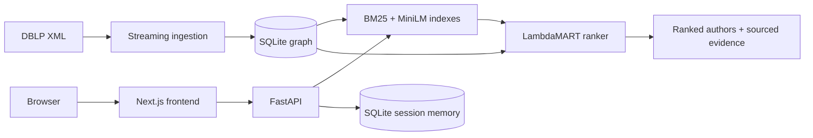

# ScholarGraph — research expert discovery

ScholarGraph finds researchers in public DBLP publication data. It combines a dated, source-backed collaboration graph, lexical and semantic search, and a trained ranking model. Results include publication evidence; a graph assistant supports follow-up searches, profiles, collaboration paths and session decisions.

- [Live application](https://scholargraph-one.vercel.app/) · [API health](https://34.100.138.196.sslip.io/health) · [Frontend API health](https://scholargraph-one.vercel.app/api/health)
- [Design document (PDF)](docs/design.pdf) · [Results and reproducibility](resources/evaluation/README.md) · [AI-use statement](docs/ai-use-statement.md) · [Operations and configuration](docs/operations.md)

## Architecture



## Run the application

Requirements: Docker and Docker Compose. From the repository root:

```sh
docker compose up --build
```

Open **http://localhost:3000** and search for `graph neural networks`. The first start prepares the bundled 200-paper sample. The API health endpoint is http://localhost:8000/health. Press Ctrl+C to stop.

The initial image build downloads dependencies and local models. Once built, the application runs without API keys. No `.env` file is required; copy [.env.example](.env.example) to `.env` only to configure optional Gemini access. Never commit keys. Local development, voice and deployment settings are in [operations](docs/operations.md).

## Offline batch interface

With Python 3.12 and the pinned runtime dependencies installed, run:

```sh
./run --data resources/examples/sample.xml --queries resources/examples/queries.txt --out /tmp/hiresense-results.json
```

Replace the sample XML and query file with a DBLP-format XML slice and one query per line. The JSON output contains ranked people, scores, explanations and supporting evidence. The prepared runtime and included models need no network access or keys for this command.

## Features

- Search using BM25 and local MiniLM embeddings, with a trained LambdaMART author ranker and date filters.
- Inspect sourced publication evidence, author profiles, topics, timelines and collaboration paths.
- Open the shared assistant from any search result or researcher profile, with that profile attached as context. Shortlist and reject decisions remain in the search session and can be deleted.
- Use a separate text and voice conversation workspace with optional configured model providers.
- Rebuild temporal datasets, train and evaluate models, and run offline tests.

The reference app uses DBLP author PIDs when available; noisy-author linking is a separate experiment. The API also exposes a separate command-based graph assistant; its tools and memory are covered by backend tests but are not currently exposed in the shared conversation panel. General conversation responses are not verified graph claims. The app has no accounts or tenant isolation. See the [design](docs/design.md) for trade-offs and safety boundaries.

## Results

On 500 inspected 2025 future-paper queries against a graph through 2024, the trained model measured **nDCG@10 0.0354** and **MRR 0.0488** within up to 800 candidates. BM25 measured 0.0245 / 0.0338; pretrained dense retrieval measured 0.0268 / 0.0361. Future authorship is an incomplete proxy for relevance, not a measure of hiring accuracy. The [results file](resources/evaluation/README.md) includes the ablation, limitations, reports, frozen inputs and replay instructions.

## Tests

After installing the pinned Python and web dependencies:

```sh
PYTHONPATH=src .venv/bin/python -m unittest discover -s tests -v
(cd web && npm test && npm run build)
```

Browser tests require the application and Playwright Chromium: `cd web && npm run test:e2e`. For the Compose smoke test, start with `docker compose up --build -d --wait`, run `python scripts/check_compose.py`, and stop with `docker compose down`. GitHub Actions runs backend, frontend, browser and Compose checks.

## Technology and layout

**Stack:** Next.js, React and TypeScript; FastAPI and Python; SQLite; BM25, MiniLM/ONNX and LambdaMART/LightGBM; Docker Compose; Vitest and Playwright.

```text
src/hiresense/    Ingestion, graph, retrieval, ranking, API and assistant
web/              Next.js interface and frontend tests
models/           Local encoders and trained ranking models
scripts/          Preparation, reproduction, startup and checks
resources/        Sample data, contracts, evaluation inputs and results
tests/            Offline Python tests
docs/             Design, operations and AI-use statement
run               Offline batch entry point
```

DBLP data is public and released under CC0. The deployed demo uses a prepared snapshot; it does not automatically ingest new releases.
