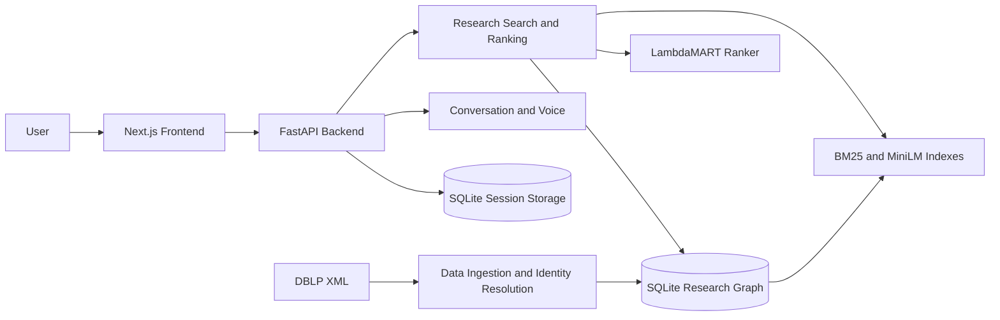

# ScholarGraph — Research Expert Discovery

ScholarGraph is an **AI-powered research expert discovery system** that identifies researchers from public DBLP publication data. It combines a **research collaboration graph**, **hybrid search**, and a **machine learning ranking model** to match research topics with relevant authors. A Next.js interface presents researcher profiles, supporting publications, and collaboration evidence, while a Python API powers search, conversations, and voice interaction.

## Architecture



- **Frontend:** Search for researchers, inspect profiles and evidence, maintain shortlists, and use text or voice conversations.
- **Backend API:** Serves research search, author profiles, session memory, conversations, and voice endpoints.
- **Research graph:** Stores publications, authors, and dated collaboration relationships in SQLite.
- **Retrieval and ranking:** Combines keyword and semantic search with a trained model to rank author candidates.
- **Local storage:** Keeps research data and session state in separate SQLite databases.
- **Offline execution:** Research search and batch inference run without API keys once dependencies and data are prepared.

## ML Pipeline


The serving pipeline retrieves up to **1,024 papers per search channel** and combines their evidence into up to **800 author candidates**. The selected 80-tree LambdaMART model ranks candidates using research relevance and graph features. Scores are ranking signals, not probabilities.

The [temporal evaluation](resources/results/lean-final-v1.json) reports nDCG@10 of **0.0354** and candidate-list MRR of **0.0488** on 500 queries. Future authorship provides incomplete proxy labels; independent human relevance review is pending. See [evaluation details](resources/results/README.md).

## Features

### Researcher Search

- Search for experts by research topic using **BM25 keyword search** and **MiniLM semantic embeddings**.
- Apply supported publication-year and recency filters.
- Rank authors using publication evidence, topical relevance, recency, and collaboration features.

### Research Profiles and Evidence

- Explore author profiles, publications, publication years, and collaborators.
- Review source-backed evidence explaining why a researcher appeared in results.
- Shortlist or reject researchers and manage search-session memory.

### Research Graph and Data Processing

- Parse DBLP XML and resolve author identities into a dated research graph.
- Build local paper indexes for keyword and semantic retrieval.
- Run batch discovery against a DBLP XML slice and a list of research queries.

### Conversations and Voice

- Use persistent text conversations with optional research-record lookup.
- Attach UTF-8 text, Markdown, CSV, and JSON documents as bounded model context.
- Use local Vosk speech recognition and Piper speech synthesis, or configure supported remote providers.
- Stream responses from a configured local, Ollama, or OpenAI-compatible model.

### Training and Evaluation

- Rebuild temporal graph snapshots and train an experimental LambdaMART ranker.
- Evaluate retrieval and ranking against future-authorship proxy labels.
- Run backend, frontend, and browser tests.

The conversation workspace is currently independent of the graph-tool assistant backend; the complete search → three-tool assistant → shortlist journey is not yet integrated. The application has no account authentication and is intended for local use.

## Tech Stack

### Frontend

- **Next.js, React, TypeScript:** Application interface and API proxy.
- **CSS:** Application styling.
- **Vitest and Playwright:** Component and browser testing.

### Backend and Data

- **Python 3.12, FastAPI, Pydantic, Uvicorn:** API and data-processing services.
- **SQLite:** Research graph and separate session storage.
- **DBLP XML:** Bibliographic source data.
- **NumPy and scikit-learn:** Numerical processing and supporting ML utilities.

### Machine Learning and Voice

- **BM25 and MiniLM:** Keyword and semantic paper retrieval.
- **ONNX Runtime:** Local encoder and cross-encoder inference.
- **LambdaMART and LightGBM:** Learning-to-rank inference and training.
- **llama-cpp-python, Ollama, or an OpenAI-compatible endpoint:** Optional conversation model providers.
- **Vosk and Piper:** Optional local speech recognition and synthesis.

### Infrastructure

- **Docker and Docker Compose:** Containerized application deployment.
- **unittest:** Python test suite.

## Codebase Structure

```text
src/hiresense/
├── data/          DBLP ingestion, preparation, and temporal history
├── graph/         Graph construction, author resolution, and queries
├── retrieval/     Indexes, encoders, and hybrid search
├── ranking/       Ranking features, model scoring, and evidence
├── evaluation/    Retrieval, ranking, and assistant evaluation
├── api/           FastAPI application, schemas, and runtime
├── assistant/     Grounding, providers, safety, and memory
├── conversation/  Conversation routes
├── voice/         Speech routes and providers
├── batch.py       Offline batch pipeline
└── cli.py         Preparation and server commands
web/               Next.js application and frontend tests
models/            Local ONNX encoders and ranking models
scripts/           Startup, preparation, training, and evaluation commands
config/            Pinned dependency files
resources/         Sample data, contracts, experiments, and results
tests/             Python tests
data/              Local data, indexes, downloaded models, and session state
docs/              Architecture and design documentation
run                Offline batch entry point
```

## Running Locally

### Docker Compose

Requirements: Docker and Docker Compose. Run from the project root:

```bash
docker compose up --build
```

Open **http://localhost:3000**. The API health endpoint is at **http://localhost:8000/health**, and its schema is at **http://localhost:8000/openapi.json**. The first startup prepares the included 200-paper DBLP sample in a Docker volume. Search for `graph neural networks` to try it. Press `Ctrl+C` to stop the application.

Building the images requires network access for dependencies and speech models. Full Compose startup was not verified on the original machine because its Docker daemon failed to start. The optional conversation model is not included in the image and requires separate configuration.

### Local Development

Requirements: Python 3.12, [uv](https://docs.astral.sh/uv/), Node.js, and npm.

```bash
uv venv --python 3.12 .venv
uv pip install --python .venv/bin/python -r config/requirements.lock
(cd web && npm ci)
./scripts/start-local.sh
```

Open **http://127.0.0.1:3017**. The script starts the API on port `8017` and the frontend on port `3017`. It uses a prepared larger graph when available or prepares the bundled sample. Set `HIRESENSE_CONFIG`, `SCHOLARGRAPH_BACKEND_PORT`, or `SCHOLARGRAPH_WEB_PORT` to change the defaults. Press `Ctrl+C` to stop both services.

### Offline Batch Search

With the Python runtime dependencies installed:

```bash
./run --data resources/examples/sample.xml --queries resources/examples/queries.txt --out /tmp/hiresense-results.json
```

Use your own DBLP-format XML file and a text file with one query per line to process another dataset. The command creates a temporary graph and index and writes ranked researchers and supporting evidence to JSON. The bundled sample is a functional demonstration, not an accuracy benchmark.

### Conversation Model

Install the optional local model runtime and download the small fallback model:

```bash
uv pip install --python .venv/bin/python -r config/requirements-llm.lock
.venv/bin/python scripts/prepare_query_model.py
```

The default model is a small 0.5B fallback with limited instruction following and reasoning. Alternatively, configure Ollama or an OpenAI-compatible endpoint with the `SCHOLARGRAPH_CHAT_*` settings in [.env.example](.env.example). Export settings before starting the local script, or place them in a root `.env` for Compose, and restart the API after changes. The Docker image does not include the local conversation model or `llama-cpp-python`.

### Voice

For local voice outside Docker, install the optional dependencies and download the speech models:

```bash
uv pip install --python .venv/bin/python -r config/voice-requirements.lock
.venv/bin/python scripts/prepare_voice.py
.venv/bin/python -m piper.download_voices --data-dir data/models/piper en_US-ljspeech-medium
```

Open **Conversations → Voice** and allow microphone access. Localhost or HTTPS is required for microphone access. The first request may take longer while models load. Docker downloads speech assets during its image build. Remote speech settings are listed in [.env.example](.env.example); keep credentials in the API server environment. Remote providers receive the relevant messages, excerpts, or audio.

### Training and Evaluation

Install training dependencies and provide the exact DBLP archive identified in `resources/experiments/lean-cohorts.json`:

```bash
uv pip install --python .venv/bin/python -r config/requirements-training.lock
PYTHONPATH=src .venv/bin/python scripts/rebuild_lean_data.py --archive data/raw/dblp.xml.gz --out data/processed/lean-rebuilt
PYTHONPATH=src .venv/bin/python scripts/train_lean.py --data data/processed/lean-rebuilt --work /tmp/lean-train --report /tmp/lean-validation.json --freeze /tmp/lean-freeze.json --model /tmp/lean-model.json
PYTHONPATH=src .venv/bin/python scripts/evaluate_lean.py --data data/processed/lean-rebuilt --freeze /tmp/lean-freeze.json --out /tmp/lean-final.json
```

These commands write an experimental reproduction to fresh paths without overwriting the selected model. The final test has already been inspected and is for reproduction, not model selection. See [evaluation and reproduction details](resources/results/README.md) for the frozen source and package requirements.

### Tests

```bash
PYTHONPATH=src .venv/bin/python -m unittest discover -s tests -v
(cd web && npm test && npm run build)
```

With the API and frontend running, execute browser tests with `cd web && npm run test:e2e`. Install Playwright Chromium first or set `CHROMIUM_PATH`.

## Documentation

- [Architecture diagrams](docs/architecture.md)
- [Design document](docs/design.pdf)
- [Evaluation and reproduction](resources/results/README.md)
- [Local data and generated artifacts](data/README.md)
