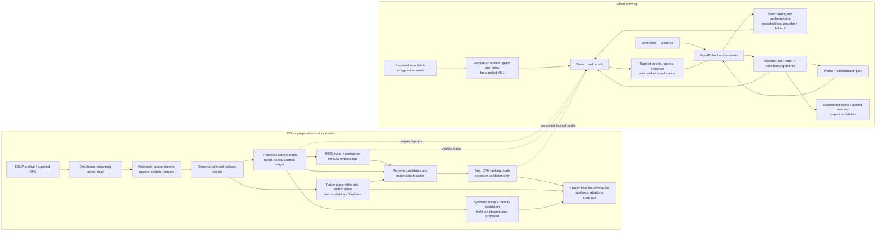
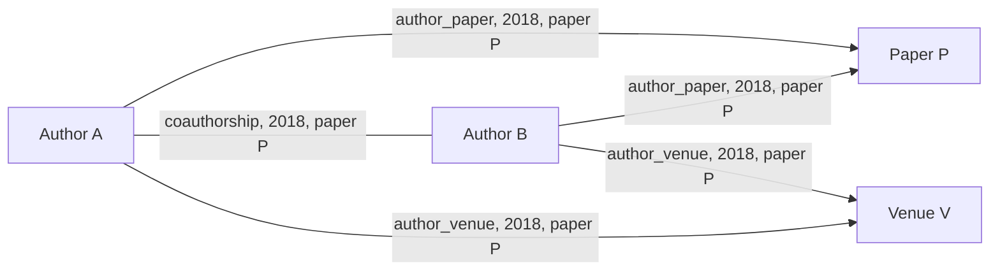

# HireSense: architecture and joint experiment plan

**Historical context:** This document records earlier architecture decisions. The static frontend has since been retired and `web/` is reserved for the planned Next.js implementation; see the README for the live layout.

This is a working decision document for discussion, not the assignment's final two-to-three-page design PDF and not a report of new experiments. The application code and model have not been changed as part of this document. Status labels distinguish what exists, what is proposed, and what must be measured.

**Current review:** Hybrid training and reserved evaluation have now run. This document preserves the earlier architecture/planning discussion. See [hybrid experiment (archive: hybrid-experiment.md)](historical.zip) for the completed experiment and [system review and recovery plan (archive: system-review-and-recovery-plan.md)](historical.zip) for current quality findings, missing product work and proposed goals.

## 1. What we are building

An offline-first expert-finding product over DBLP. A user describes a research problem; the system ranks researchers and cites dated publications and relationships as evidence. A conversational assistant can search, inspect a profile, find a collaboration path, and remember or forget shortlist/reject decisions. A reviewer can also run `./run --data ... --queries ... --out ...` against a different DBLP-style XML slice without a network or API key.

The assignment requires a pipeline capable of at least 50,000 papers, not exactly 50,000, and a model trained by us. It does not mandate a neural model, notebook, GPU, Kaggle, an accuracy threshold, or a particular database. The design should justify choices, quantify results on our own data, and remain reproducible on an unseen slice. The assignment also requires a React/TypeScript or justified equivalent UI, Compose, CI, evaluation, a short design PDF, and submission materials. The UI, Compose and CI remain future work.

### The current evidence and why we want another experiment

| Measurement | Existing run | Interpretation |
|---|---:|---|
| Source selection | First 50,000 matching DBLP records in source order | Convenient but not representative of DBLP; it contains 34,171 incollection and 15,829 inproceedings records. |
| Historical graph | 41,786 papers; 61,185 authors; 359,808 typed edge events | Graph built through 2018. |
| Held-out ranking | 3,074 2023–2026 paper-title queries; nDCG@10 0.02168, MRR 0.03938 | Better than the measured baselines but low absolute scores. Future authorship is only a proxy for expertise. |
| Relevant-author history | 3,324 / 15,997 = 20.78% | Most held-out relevant author instances cannot be retrieved from the available historical graph. |
| Hybrid candidate recall | 4.81% of all relevant authors; 23.13% of relevant authors with history | A reranker cannot return an author who was never retrieved. The denominators differ. |
| Identity experiment | 99.996% match precision, 91.61% recall | Optimistic setup: canonical profiles include the same paper that generated each noisy observation. It is known-identity linkage, not open-world clustering. |
| Trained model | 80-tree gradient-boosted classifier, exported to `models/expert_ranker.json` | Trained on 26,523 candidate examples from 782 usable training queries. MiniLM is pretrained and unchanged. |

The values come from the existing `resources/results/phase23.json` and `resources/results/data-benchmark.json`; no new accuracy is promised. The earlier ranking metrics were reproduced against the prepared graph and the ranker was retrained byte-for-byte during the prior audit. Those checks reproduce the existing experiment, including its limitations.

## 2. End-to-end architecture

The supplied batch slice is indexed at runtime and scored by the existing trained model: it is not silently added to the evaluation graph or retrained on its queries. The default backend can serve its prepared graph; a new XML slice requires preparing another backend graph/index. A new frontend should call the API only. Session storage is separate from research data. Network-free execution refers to runtime after dependencies and bundled model files have been prepared.

### Current versus proposed

- **Exists:** Python streaming ingestion, SQLite data store, frozen temporal snapshots, typed graph, synthetic noise and matcher, BM25/MiniLM retrieval, feature-based trained reranker, batch command, FastAPI, bounded assistant, session memory, grounding checks and offline tests.
- **Needs better evidence:** diversified history, held-out identity observations, candidate recall, results across fields and time windows, and a final untouched evaluation after design choices are frozen.
- **Proposed, not implemented:** a repeatable sampling/coverage experiment, stricter identity test, retrieval improvements chosen on validation, graph expansion or author profiles if an ablation supports them, user-led training runs, and a browser interface.
- **Not present:** React client, Compose, CI, final submission PDF and recording. The scale design below is a proposal, not a measured 50-million-paper deployment.

## 3. Data design: more coverage before claiming better accuracy

### Selection options

| Choice | Benefits | Risks / costs | Recommendation |
|---|---|---|---|
| Increase the first-N source-order slice | Simple, compatible with the existing slicer | Preserves source-order bias and may add many papers without adding useful historical coverage | Useful only as a controlled baseline. |
| Deterministic seeded or hash-based paper sample over the whole file, with year/type/venue strata | Reproducible, broader venue and time representation | Isolated papers can still break author history; requires a full archive scan and new tooling | Use for a broader discovery/benchmark dataset. |
| Larger, contiguous history for selected subjects or venues, with future labels in those fields | Better chance of retaining repeated author histories and coherent graph neighborhoods | Less representative of the whole corpus; venue and time choices can bias results | A useful complementary field-specific experiment, chosen without inspecting final test outcomes. |
| Author-history closure around selected future papers | Improves historical coverage for a defined evaluation cohort | Selection depends on future author identities; can bias the cohort and make history coverage optimistic, even when no future features enter the graph | Optional explicitly labeled diagnostic only; never call it representative. |
| All DBLP | Maximum available coverage | Full scan, indexing, large RAM/disk use, slow exact search and graph construction | Do not assume this laptop or current implementation can handle it. Profile first. |

For a first controlled pilot, propose a **broader 150k–250k-paper pool**, not a new minimum or a promised improvement. Fix the same temporal boundaries, seeds, sampling rules, and future query cohort in advance for a size comparison. Compare nested historical graphs—for example, a smaller and a larger historical subset—against the *same* fixed future evaluation queries and all-author denominator. Where feasible, vary size and sampling strategy separately so changes can be attributed. Report exact record types and venue/year distribution. If resources are tight, begin with smaller pilot subsets; if coverage remains poor and resources permit, grow further. Decide based on measured improvements and resource use.

Do not compare the old 50k test score to a larger dataset's different test cohort as proof that size helped. To choose a design, use validation; freeze the pipeline before running an untouched final test. Because the old test has already been inspected, reserve a new, predeclared untouched field/time cohort (with no overlap or duplicates) for the next final generalization check. Its availability and sufficient history must be measured rather than assumed. Never use future titles/authors as graph features; selecting a cohort using future identities is a separate, declared selection effect even if graph timestamps remain clean.

### Record and artifact flow

1. Verify the raw archive checksum and record its version/hash. Stream and normalize supported records; preserve DBLP keys, disambiguated author identities, year, venue and type. Log exclusions and reason counts.
2. Persist canonical source records. Make re-ingestion idempotent by stable keys and update/rebuild derived artifacts if source records change.
3. Choose a historical cutoff and distinct subsequent train, validation and final-test periods. Check graph years, source-paper keys and normalized titles; exclude repeated titles and document other possible overlap. Missing history is part of the full metric denominator.
4. Materialize a historical graph and a separate evaluation-label dataset. The serving graph may use all records in a supplied new XML slice, whereas a benchmark graph is frozen at its cutoff. Keep those modes and artifacts distinct.
5. Track source/config/code/dependency hashes, seeds, graph/index/model signatures, elapsed time and resource observations. Raw DBLP and generated indexes remain outside the submission archive; provide scripts and small sample/model artifacts.

## 4. Context graph: what it is and why it matters

A graph is a way to represent entities and their relationships, not necessarily a graph database or graph neural network. The present graph uses SQLite records and typed edge events. A publication can support:

Each edge has a type, date and source paper key. Coauthorship is undirected but is stored once per ordered author pair per supporting paper; two joint papers produce two sourced events. The graph can answer who wrote a paper, where someone published, who collaborated, what facts support an explanation, and which short collaboration path connects two authors. Current ranking uses graph-derived features such as collaborator count; direct graph-neighbor candidate expansion is an optional proposal, not a claim about current behavior.

Identity is foundational: a false merge attaches one person's papers, topics and collaborators to another. We therefore prioritize precision and allow uncertain matches to abstain. The current generator corrupts observed names but the matcher can see the target paper's own coauthors, venue and year in a canonical profile. For a stronger experiment, construct reference profiles **without the target observation**, or hold out a later set of observations while retaining only earlier evidence. Keep unknown/new authors as explicit cases, report candidate recall, false merges, false splits/abstentions, and precision/recall by corruption and context availability. Measure linkage separately from open-world clustering; do not call the former the latter. Calibrate thresholds on development data and freeze them before test.

### Alternatives and scaling

- **SQLite adjacency/edge tables:** appropriate for an offline assignment and local transactions; easy provenance and joins. Large graph traversals and concurrent writes become bottlenecks.
- **PostgreSQL plus edge tables:** stronger multi-user operations and indexing, but adds a service and deployment cost.
- **Graph database:** expressive traversals and specialized graph tooling; adds operational complexity and is not required for this assignment.
- **Graph neural network / graph embeddings:** can learn neighborhood representations, but need careful time-aware training, more compute and a meaningful graph ablation; a GNN is not required to have a valid context graph.

Coauthor pair expansion grows approximately as `n(n-1)/2` for a paper with `n` authors. Large teams can dominate storage and runtime. Profile team-size distributions, place explicit policy around unusually large teams, and preserve an author–paper path if pair edges are bounded. Any pruning is a design change whose effect on collaboration paths and recall must be measured.

## 5. Retrieval, indexing, features and reranking

### Indexing and batching

- **Lexical index:** SQLite FTS5 stores paper titles for BM25 word matching. It is good for exact technical terms but may miss synonyms.
- **Dense index:** pretrained MiniLM encodes paper titles as 384-dimensional vectors; query and paper vectors are compared by cosine similarity. It can recover semantic similarity but can miss rare exact terms and costs compute/storage.
- **Batching:** encoding processes groups of texts rather than loading a model for every title. Feature materialization processes many labeled queries and caches their candidate features; the batch interface also accepts multiple query lines, while building the temporary graph/index once for the provided slice. Batch size is a throughput/memory choice and should be profiled. No specific safe size is guaranteed for every machine.
- **Current search:** lexical and dense paper hits are aggregated to authors and combined with reciprocal-rank fusion. The current experiment uses a paper limit of 256 and author candidate limit of 200. These are configurable experiment budgets, not assignment requirements.
- **Potential next steps:** validation-only experiments with candidate budgets, author topic profiles, or bounded graph-neighbor expansion. Measure candidate recall before and after; extra candidates can increase latency and introduce noise.

### Why rerank?

Retrieval narrows a potentially huge corpus to plausible candidates. Reranking orders those candidates using richer evidence. If Alice has one strongly relevant paper and Bob has many unrelated papers, a simple paper-count ranking might prefer Bob. Features such as best lexical match, best and top-three dense similarity, title-term coverage, normalized topical support, publication recency, total publications, collaborator count, and initial hybrid rank help the learned model weigh the evidence. A ranker cannot repair a missing candidate; that is why coverage and candidate recall are separate measurements.

The current model is a gradient-boosted **classifier used as a reranker** over these candidate features, with its score blended with a hybrid retrieval prior. Its output is a ranking value, not a calibrated probability of being the best expert. Training examples treat future authors as positives and sampled retrieved non-authors as unjudged contrasts; many other researchers may also be suitable. Class/query weights limit domination by large candidate lists. There are 12 currently defined features. The 80 shallow trees and blend weight are selected on validation, and portable JSON stores the fitted tree thresholds and values.

Alternatives: manually weighted BM25+dense is simpler and is a strong baseline; logistic regression is easy to explain and fast; pairwise/listwise gradient-boosted ranking may fit the task more directly but needs careful grouped labels and comparison; a cross-encoder can jointly read query and title but costs more per candidate; fine-tuning an embedding model needs more data, compute and leakage controls. No model is automatically best. Select using validation metrics, latency, portability, and the ability to explain and reproduce it. Evaluate the final chosen model once on the untouched final cohort. A held-out test is not a tuning dashboard.

## 6. How we will train the model together

The assignment says to train at least one model ourselves. It permits AI coding tools and requires us to explain and defend the submission; it does **not** say the human must manually implement every line or use a specific notebook. Still, the user should understand and direct the experiment. The existing trained tree model is a real trained model, but its previous AI-led process did not provide the desired level of human participation. We will treat it as the baseline, not hide or relabel its provenance.

### Proposed collaborative steps

1. **Inspect together:** open a real graph edge, a ground-truth label, and a candidate feature row. You explain what each means; I help trace the relevant code and answer questions.
2. **Agree on the hypothesis and resources:** for example, "broader historical coverage increases candidate recall at a tolerable runtime". You choose the scope, dataset design, boundaries and success criteria with my recommendations. Preserve a new final cohort.
3. **Prepare data:** after the design is agreed, implement the minimum needed sampling and strict identity evaluation, with reviewable changes and tests. Run a small pilot first and inspect excluded/retained records and leakage checks.
4. **Train yourself with assistance:** you execute or explicitly direct a visible command/notebook run; I explain each parameter and output, help inspect logs, and avoid silently making experiment decisions. Record actual command, seed, paths, code version, system and timings. A run is still valid if we collaboratively write the script; the important part is that you can explain it and accurately describe the AI's contribution.
5. **Compare on validation:** inspect lexical, dense, hybrid and learned results, coverage, candidate recall and at least one ablation. Investigate errors and resource cost before choosing a model. Select thresholds/settings only here.
6. **Freeze and evaluate:** write the chosen configuration/model and then evaluate once on the new held-out cohort. Record results even if the new approach performs worse. Do not edit an existing result to suggest it came from the new code.
7. **Serve and demonstrate:** load the exact exported trained artifact in the batch and backend paths. Verify feature/schema compatibility, inference equivalence with the trained estimator, model hashes and offline operation on an unseen XML fixture. Include the genuine training command and artifacts in the final results.

### Where should training run?

| Option | What it provides | Trade-off |
|---|---|---|
| Local Python script on this machine | Same code path as serving, simple reproducibility, no cloud or keys; suitable first choice for a small tree model | CPU and memory limits; can slow the laptop. |
| Local Jupyter notebook calling the same project functions | Interactive inspection, charts and step-by-step participation | Notebook state can be hidden/out of order; keep the script/config as the reproducible source of truth and record a clean run. |
| Kaggle / other hosted notebook | May provide more compute and visible interactive execution | Environment/data transfer and availability vary; potential quotas, privacy and reproducibility concerns. Export the small model and preserve dependency/data provenance; submission runtime must still work offline. |
| GPU fine-tuning | Potentially more expressive retrieval or reranking | Longer setup/training, larger model and harder offline deployment; not required and must beat simpler baselines on the same evaluation. |

Current machine snapshot: Ryzen 7 5800HS, 8 cores / 16 logical CPUs, 15 GiB RAM, approximately 4.1 GiB available at inspection, no swap, and about 252 GiB free disk. Available memory changes as other applications run; GPU compute availability has not been verified. Limit threads, monitor RAM, and measure a pilot before scaling. The current index builder materializes all paper vectors in memory and coauthor edge counts can grow quadratically with team size, so a very large experiment may require a future streaming/indexing change; a bigger limit alone is not a safe scaling plan. Disk space alone does not establish feasibility.

## 7. AI assistant, safety and operations

Query understanding converts a user query into schema-checked topics and recency constraints. The default provider replays a limited set of real recorded Qwen outputs; unknown or invalid outputs fall back to deterministic parsing. Live local Qwen is optional and its larger model file is not necessary for default operation. Graph tool calls are selected by the server's bounded routing rules and validated, not granted by text embedded in a paper. Source text is data. Explain results using typed facts and supporting paper/edge IDs and check those facts; current checks do not establish correctness of arbitrary generated prose.

Sessions keep shortlist and reject decisions, apply them to later searches, expose applied memory and allow deletion. Concurrent requests use versions and retry identifiers. Keep research data separate from session state and avoid logging sensitive query/session content. Offline tests include the time split, idempotency, incorrect merges and prompt injection; the earlier suite has 63 passing tests. The web UI still needs accessible controls, cancellation of stale searches, clear loading/empty/error states, safe rendering, component tests and at least one end-to-end flow.

For the assignment's 50-million-paper / 200-QPS / p95-500-ms *design question*, a possible architecture is bulk ingestion into partitioned storage, separately versioned graph snapshots, distributed lexical and approximate-vector indexes, precomputed author features and neighborhoods, cached hot queries, stateless API replicas, and bounded expensive reranking. Shard and replicate by workload, add backpressure and observe latency, freshness and failure recovery. Main trade-offs are approximate recall, cost, index freshness, consistency and operational complexity. Coauthorship blow-up and hot authors need special care. Load-test the actual deployed system before making a performance claim; none of those target figures has been measured here.

## 8. Decisions and checks for our next session

Decisions for us to make together:

1. Choose local script or a local notebook that calls the same project functions for the first training session.
2. Choose the first pilot's compute/time limit and the broader dataset strategy. The 150k–250k range is a proposal, not a fixed goal or measured optimum.
3. Agree on a predeclared validation comparison and reserve a new untouched final cohort. Track author-history coverage, candidate recall, nDCG@10, MRR, identity errors, memory, runtime and size; report both all-author and known-history views with denominators.
4. Review strict identity evaluation and graph provenance before deciding whether higher model complexity is warranted.

No new experiment, dataset size, model accuracy, or production throughput is claimed by this plan. The user chooses when and how to start the next implementation/training session.
