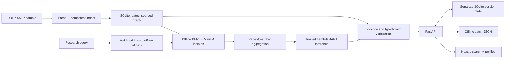
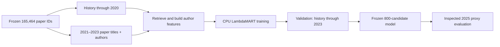

# Architecture and data flow

The diagram describes the current research-search path. It is not a capacity claim or live telemetry.

Training is separate from query-time inference:

The 2025 test is no longer untouched. Future-paper authors are incomplete proxy labels, and non-authors are unjudged. The API's command-based graph assistant exposes three validated tools and session memory; the shared conversation UI can attach a researcher profile but does not expose those graph tools or memory. The 50-million-paper scale-out proposal is in the [design document](design.md); it has not been load-tested.
