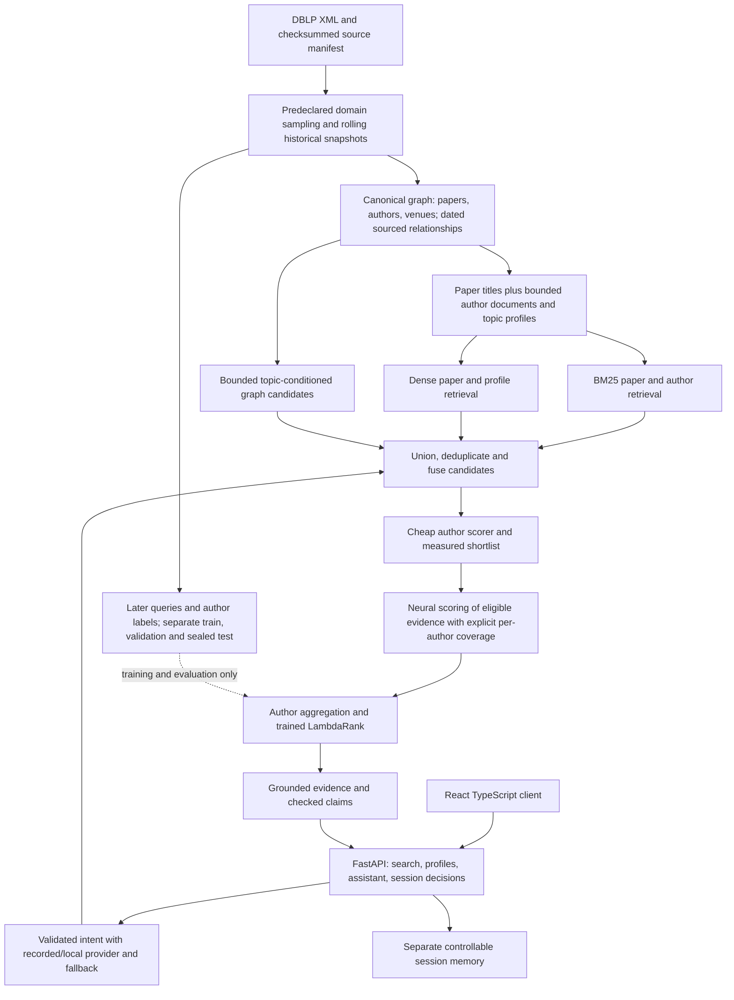

# HireSense assessment review and recovery plan

Review date: 5 November 2026. This review covers the supplied assignment PDF, current Python implementation, configurations, saved training/evaluation reports, and additional analysis of the frozen predictions. It introduces no model retraining, application changes or new performance claims. Targets below are proposed engineering goals, not measured results or assignment requirements.

**Decision.** Keep the functioning data/graph/API foundation. Improve retrieval and evidence scoring through a bounded, controlled experiment while building the missing web application and delivery workflow. A measured backend is available; useful expert discovery and the complete assessment submission are not finished. Repeatedly increasing model complexity while deferring the product is an ineffective use of effort.

**1. What the assignment actually requires**

The assignment asks for one cohesive product: offline DBLP ingestion, a dated and sourced context graph, author resolution with measured precision/recall, lexical and dense retrieval, at least one model trained by us, grounded explanations, a tool-using assistant with controllable memory, a usable web interface, reproducible tests and operations, and a candid design/results submission. Its estimate is 10–12 focused hours, it explicitly says nobody is expected to complete every item, and it rewards prioritization. It specifies no minimum nDCG, MRR, graph size beyond 50,000 processed papers, neural architecture, GPU, or database brand.

A trained feature ranker satisfies the model-training requirement. Our final LambdaRank model was actually trained locally; the pretrained MiniLM encoder and cross-encoder were not fine-tuned. AI coding assistance is allowed; the submitter must understand and defend the decisions. A Jupyter notebook is optional and does not by itself improve model quality.

| Requirement | Current evidence | Status and gap |
|---|---|---|
| Parse/clean at least 50k DBLP papers; temporal labels and synthetic noise | Streaming ingest, source checksums, 272,592-record latest source, separate historical graphs and label manifests, idempotency and split tests | Implemented; source selection and coverage need improvement |
| Resolve noisy authors using contextual evidence and bounded candidates | Name/coauthor inverted blocks, venue/year features, conservative/strict abstention policies; held-out linkage report | Implemented and measured; recall is weak; synthetic known-reference linkage is not open-world clustering |
| Typed, dated, sourced graph; idempotency | Author–paper, author–venue and coauthorship edge events, graph audits, ingestion repeat checks | Implemented; edge counts describe sourced events, not unique collaborations or proof of relevance |
| Lexical+dense retrieval; own trained model; baselines and ablation | SQLite FTS5, MiniLM, profiles, graph expansion, pretrained cross-encoder, trained LambdaRank; frozen reports | Implemented; absolute discovery quality remains poor |
| LLM query understanding, schema validation and fallback | Actual recorded local Qwen outputs, optional local provider, deterministic fallback | Implemented; exact-recording coverage is finite and natural-language quality is limited |
| Grounding, three tools, controllable memory, injection defenses | Search/profile/collaboration, claim verifier, revision/idempotency controls, memory inspect/delete, offline tests | Implemented within a bounded command grammar; not a general conversational planner |
| Six or more multi-turn scenarios and task/injection evaluation | Historical 10-scenario report; malicious query/source/provider tests | Exists; regenerate scenario evaluation against the final current application and graph |
| Ranking metrics, error analysis, leakage checks, simple fairness check | Fixed comparisons, frozen hashes, failure cases; eight-query name-display swap with no ranking changes | Exists; tiny counterfactual is not demographic fairness; new distributional tests needed |
| Web search/results/profile/assistant/shortlist, accessibility, component and end-to-end tests | API contracts exist; no web implementation found | Missing |
| `docker compose up`, exact setup in five commands or fewer | Python/API instructions and clean-copy check exist; no Compose/Docker application setup found | Missing; current large backend points to generated local data |
| Health/logging, offline tests, CI | Health/logging and 74-test saved clean-copy result | Backend checks exist; CI configuration missing |
| Two-to-three-page design PDF, scale/privacy/future directions | Longer working architecture notes exist | Final PDF missing; reconcile stale historical planning notes |
| Results/commands, AI-tools statement, 3–5 minute recording, clean package | Many versioned result files and commands; `.env.example`; models total about 46 MB | Results exist; concise submission index, AI statement, demo recording and clean packaged application still needed |

There is no defensible single completion percentage without arbitrary weights. “Implemented backend functionality,” “ranking quality,” and “full assignment delivery” must be tracked separately. Earlier statements of completion were too broad when interpreted as final product quality or assessment readiness.

**2. What our scores mean**

The headline evaluation has 1,000 future-paper-title queries from 2025–2026. A paper's actual authors are binary relevant labels. Features and evidence at final inference come only from the graph through 2024. Training and validation used an older graph through 2018, with labels in 2019–2020 and 2021–2022 respectively. This is a declared rolling-inference evaluation with a changing graph, not a same-snapshot comparison.

- nDCG@10 averages discounted relevance in the first ten results, normalized by an ideal ordering using the full relevant set. A relevant result near the top earns more. Our .0543 is approximately 5.43% of ideal discounted gain on average under these labels. It is not 5.43% classification accuracy.
- MRR averages the reciprocal rank of the first labeled relevant author; a query with no retrieved relevant author contributes zero. Our .0770 uses lists capped at 400 authors. Taking its inverse does not yield the average rank. It is not a 7.70% success rate.
- Hit@10 is the fraction of queries with at least one labeled relevant author among the first ten. We measured this separately: 12.9%. Hit@1 is 5.3%.
- Candidate recall measures the share of relevant author instances reaching the candidate pool before reranking. Known-author recall restricts the denominator to relevant authors present in the historical graph. History coverage is the share present in that graph. These are separate failure mechanisms.

The task measures whether future authors can be found from past evidence. It does not establish who is best suited for a hiring/research problem. A researcher absent from a paper's authors can still be a suitable expert; a coauthor need not have equal expertise on every topic. Noisy labels partly limit interpretation, but they do not excuse the substantial measured retrieval and ranking failures.

| Fixed 1,000-query method | nDCG@10 | MRR |
|---|---:|---:|
| Lexical baseline | .03859 | .04965 |
| Off-the-shelf dense baseline | .03653 | .04887 |
| Untrained enhanced hybrid | .04224 | .05549 |
| Reference feature classifier on enhanced candidates | .05062 | .07069 |
| Selected trained hybrid | .05432 | .07696 |
| Full-feature LambdaRank variant, frozen before test | .05552 | .08014 |

The selected model improved nDCG by approximately 28.6% relative to the untrained hybrid, but its absolute .01208 gain leaves the product weak. The full-feature variant's slightly higher test result cannot justify switching models on the test. The selected without-graph-feature variant won on validation; it still uses graph candidate expansion.

The old full system scored .00179/.00426 on these same queries. Its older graph, retrieval budget and model all differ. That comparison measures the combined system change and is not evidence of a 30-fold model-only gain. Comparisons against older scores from different cohorts likewise cannot establish improvement.

**3. Measured failure breakdown**

Additional analysis reuses the checksummed frozen labels/features/model; no model was trained and no settings were selected. See [diagnostics](../results/pipeline-review-diagnostics-v1.json).

| Relevant author instances | Count | Share of all 4,271 |
|---|---:|---:|
| Missing from historical graph | 1,934 | 45.28% |
| Present in graph, missed by candidates | 1,710 | 40.04% |
| Reached candidate pool | 627 | 14.68% |

History coverage is 2,337/4,271 = 54.72%. Candidate recall among those known authors is 627/2,337 = 26.83%. These are author instances across queries, not necessarily unique researchers.

| Exclusive query outcome | Queries | Share |
|---|---:|---:|
| No labeled relevant author in graph | 115 | 11.5% |
| Some relevant history, but none of those authors retrieved | 573 | 57.3% |
| Relevant candidate retrieved, but none placed in top ten | 183 | 18.3% |
| At least one labeled relevant author in top ten | 129 | 12.9% |

The 45.28% missing-author-instance rate and 11.5% no-history-query rate are compatible: a multi-author query may have both known and missing authors. Do not conflate their denominators.

| Diagnostic | nDCG@10 | MRR |
|---|---:|---:|
| Current selected model | .05432 | .07696 |
| Perfect ordering of current retrieved candidates | .18860 | .31200 |
| Perfect retrieval and ordering of relevant authors already in graph | .62710 | .88500 |

Both oracles use ground truth to construct an analytical upper bound. They are not trained systems, achievable forecasts or legitimate deployment inputs. Current nDCG is about 28.8% of its candidate-order oracle; there is substantial ranking headroom as well as a larger retrieval opportunity. Even perfect ordering of today's candidate set cannot produce MRR .5. Coverage alone does not explain all low scores: the existing graph supports a much larger theoretical upper bound if retrieval and ranking improve.

**4. Problems in our approach and how to correct them**

**Data selection was convenient before it was representative.** The original first-50k and first-150k DBLP records follow source order. Enrichment later added continuous ML/IR/Web venue families but preserved a mixed-domain held-out cohort. In the inspected test, WCNC contributes 226 queries, SIGIR 186 and CNML 77; CNML retrieves only two of 264 relevant author instances and has zero nDCG@10. The mix demonstrates coverage and retrieval variation, not that every communications query fails. Venue aggregates are post-hoc diagnostics, not permission to tune to those test venues.

Correction: declare the product's domain coverage first; sample evaluation queries by broad predeclared domains/years using a deterministic rule, then select historical venue families independently of author labels. Within each declared domain retain sufficient continuous historical years. Start with a bounded, measured sample; expand according to coverage, not a fixed “one million papers is best” rule. Preserve a broad transfer benchmark even if a domain-specific demo is built. Distinguish authors genuinely new in the complete allowed history from authors missing only because of our slice; establishing that requires a broader archive-history audit. No benchmark can retrieve a person who truly has no allowed evidence.

**Training history was stale relative to deployment.** All training query features come from the 2018 graph, while serving uses 2024. Recency, graph size, author productivity, topic mixtures and negative difficulty change. This is not direct future-label leakage, but it is a distribution shift.

Correction: construct rolling training examples using only the graph available before each query period. Validate on a later, similarly constructed period. For example train on several earlier cutoff→next-year windows, validate on a later window, then freeze before a new disjoint test window. Query source keys and normalized titles must not cross partitions; within any row, target paper, future edges and target authorship must never appear in evidence. Repeated authors across periods are expected in known-expert discovery; add an explicitly scoped sparse-history/cold-start cohort rather than blindly banning all author overlap. Fit IDF/topic clusters and sample negatives using only permitted data.

**We trained a final scorer before obtaining enough usable supervision.** The latest run sampled 3,000 training queries, but only 1,138 had both retrieved positives and contrasts. It trained on 75,272 rows with 2,440 positives. More trees cannot recover the supervision lost by a weak retriever. MiniLM and the MS-MARCO cross-encoder were not adapted to scientific expert finding.

Correction: improve candidate generation and then inspect learning curves over increasing training-query counts. Record usable queries, positive instances, domain/history mix and label ambiguity at each size. Keep hard and easier contrasts; coauthors and same-topic researchers can be false negatives. Inspect a sample before increasing difficult-negative mining. Ranker-only training is valid and useful, but does not demonstrate that semantic representations have learned this task.

**The neural reranker has unequal coverage.** In `retrieval/hybrid.py`, candidate authors are visited in initial fused order and their first two evidence papers are added until 64 unique papers are collected. Later authors only receive neural scores if they share a scored evidence paper. Missing cross-scores become zero with an observation flag. This can preserve initial-retrieval preference and makes neural evidence unavailable to most candidates. It is a cost/quality design weakness; the audit does not prove how much score it causes.

Across 400,000 candidate rows, 113,901 (28.48%) have observed cross-scores. Among the 627 relevant candidate instances, 470 have a cross-score and 157 do not. Coverage is 99.98% in initial ranks 1–50 but 3.67% in ranks 351–400. Sixty-four papers can cover more than 64 authors because papers have multiple authors.

Correction: make shortlist construction and evidence budget explicit. Apply a cheap author scorer, then score one best eligible evidence paper per shortlisted author before allocating second papers. Deduplicate pair inference but guarantee equal minimum coverage within the neural shortlist. Compare larger/diverse shortlists on validation, and report relevant-author survival at every pruning step. If budget cannot cover every candidate, mark missingness explicitly and use a defined non-neural fallback. Measure pair count, not just author count. Do not score all authors indiscriminately on the CPU.

**Author representations are too compressed.** The profile is a recency-weighted mean of at most ten latest paper vectors. It can discard older specialist work and blend unrelated topics. BM25 searches paper titles, not a dedicated author-level document. Maximum paper similarity can favor one generic matching title, while raw counts favor prolific authors.

Correction: compare (a) existing paper search, (b) a capped lexical author document, and (c) several semantic topic profiles per author. Start with one profile for sparse authors and a small bounded number for broader output; test counts rather than assume a value. Include recent and representative older evidence. Normalize author support by topic specificity and avoid rewarding volume alone. Preserve a path from every profile score to actual dated papers. A topical cluster is inferred, not a new verified fact about expertise.

**Graph expansion has little measured incremental retrieval benefit.** On the fixed 400 validation queries and enriched graph, paper-only hybrid finds 244/1,711 relevant instances; the enhanced retrieval finds 245/1,711. The selected model omitted two graph features. Neither result proves graphs are useless, but neither supports calling graph ranking strong.

Correction: ablate profile retrieval and graph candidate expansion separately, with the same graph/labels/budgets. Try topic-conditioned author–paper–author or author–venue–author paths with degree normalization, bounded traversal and temporal decay. Weight strong topic evidence over generic collaboration/popularity. A personalized random walk can be an experiment after basic channels are measured. Add a graph neural model only if it beats simpler methods under temporal and unseen-slice tests; transductive author-ID embeddings alone are a poor default for arbitrary reviewer-supplied slices. More edge events do not automatically increase expert quality.

**Identity precision and recall trade off sharply.** On 1,697 later observations, conservative matching makes 150 correct and one incorrect assignment: 99.34% precision, but 22.97% known-author recall. Candidate recall is 88.36%, so most remaining linkage loss is in acceptance decisions. Strict has zero observed errors among only 39 assignments and 5.97% recall; this does not establish perfect identity reliability.

Correction: inspect confidence/margin curves and errors by corruption, common-name frequency and history sparsity; improve blocking before relaxing acceptance. A contextual learned pair matcher can be compared if sufficient held-out labels exist. Keep unmatched observations provisional; never attach uncertain papers to an existing person merely to inflate recall. Evaluate component coauthor corruption as well as the current partially dropped but otherwise DBLP-derived collaborator names. The ranking graph currently uses canonical DBLP identities, not a graph reconstructed from all noisy-match outputs, so identity linkage errors are not demonstrated causes of the current ranking score. Add an end-to-end noisy-graph robustness experiment separately if extending this area.

**Weak relevance labels need complementary judgment.** Automatically labeling every non-author as irrelevant can penalize valid experts. It also makes careless query–paper fine-tuning unsafe: being a future author does not make every historical publication relevant.

Correction: retain the required automatic temporal benchmark and add a small independent human-reviewed query pool with graded relevance, using pooled lexical/dense/graph/learned outputs. Review blindly to method where practical, keep unresolved items unjudged and report judgment coverage. For training, treat a positive author’s historical evidence as a bag; select or aggregate plausible evidence rather than marking every paper positive. Multi-instance or author-level ranking losses are candidates. This human judgment set is complementary and does not replace the assignment's automatically derived labels.

**Experiments and serving are not exactly the same pipeline.** Offline ranking evaluation uses raw paper titles. `Backend.search` uses schema-checked topics from query understanding and applies date filters after retrieving/scoring. A recent-paper filter can replace displayed evidence while scores still reflect older/all-period evidence. Recorded intent extraction covers only exact saved queries. The bounded assistant grammar is safe but has limited natural-language flexibility.

Correction: preserve raw-title retrieval evaluation, and add an end-to-end API evaluation on identical queries plus natural problem statements. Compare raw text, validated extraction and deterministic fallback. Apply explicit date eligibility consistently to candidate/evidence selection and scoring, and rerank after filtering where required. Add regressions for legitimate research titles containing temporal words. Label assistant fallback/tool coverage accurately and show applied constraints. Improving the LLM alone is unlikely to solve the measured raw-title candidate misses.

**Comparisons and completion claims were too generous.** The reference classifier and LambdaRank use different contrast sampling (24 hard+8 tail versus 48+16); their comparison includes more than the objective. Feature ablations retain graph expansion and the hybrid prior. Baseline and final snapshots/cohorts differ in several historical reports. The eight-query name swap tests display-name invariance only. Old planning notes still say a newer model is untrained. The historical archive scan overlapped unrelated package edits, though training/final inference hashes were stable. A clean-copy test with prepared dependencies is useful but does not establish a fresh Compose installation.

Correction: separate component, model and whole-system comparisons. Match rows/negatives for objective comparisons, tune alternatives with comparable budgets, and state ablation scope. Keep historical reports immutable, link a current index, and append corrections. Track implementation, measured quality and submission readiness separately. A completed experiment can produce a weak model. The already inspected final cohort is now a regression benchmark; it must not be reused as the sole final selection test.

**5. Recommended architecture and alternatives**

This is an incremental extension of the existing architecture, not a rewrite. Keep SQLite and FastAPI for the assignment; switching to PostgreSQL, Neo4j, Redis and NestJS does not by itself increase retrieval relevance. Use an ANN index when corpus size or measured latency justifies it, and measure its recall against current exact cosine retrieval. Precompute profiles and graph features; expensive whole-index checks can happen during artifact validation/preparation with a measured startup policy.

| Candidate approach | What it changes | Decision rule |
|---|---|---|
| Better data/lexical author profiles and retrieval budgets | Coverage and recall with modest training complexity | First experiment; retain only channels with measured incremental recall/quality |
| Existing LambdaRank with richer evidence/rolling examples | Author ordering, small offline model | Keep as strong deployable baseline; compare controlled rows and loss/blend settings |
| Fine-tuned compact dual encoder | Learns retrieval relevance | Prioritize if known-author recall stays low after basic retrieval fixes |
| Fine-tuned compact evidence cross-encoder plus LambdaRank | Learns fine-grained relevance and author aggregation | Prioritize once candidate and shortlist survival are adequate |
| Larger scientific encoder such as SPECTER2 | Alternative scientific representation | Benchmark as a research candidate, not assumed superior; verify task adapter, title-only suitability, size and CPU cost |
| Graph neural ranking model | Learned relational features | Later experiment only with enough supervision and demonstrable inductive/temporal benefit |
| Large generative model choosing experts | Expensive unconstrained reasoning over a shortlist | Low priority for this assignment; complicates offline size, latency and factual verification |

A staged bi-encoder retrieval plus cross-encoder reranking architecture is documented by [Sentence Transformers](https://www.sbert.net/examples/sentence_transformer/applications/retrieve_rerank/README.html). Its [cross-encoder training guidance](https://www.sbert.net/docs/cross_encoder/training_overview.html) discusses domain fine-tuning, hard negatives and overfitting. These are methods to test, not evidence of gains on our data. The [SPECTER2 model card](https://huggingface.co/allenai/specter2) describes scientific/task-specific embeddings; use the appropriate pinned adapter/checkpoint rather than assuming any scientific model is best for short expert queries.

**6. Training plan and compute**

Start with the retrieval/coverage experiments on CPU. They may improve the system without neural fine-tuning. Use fresh validation query IDs from a declared source pool, and preserve the current run as a baseline.

For neural training, use a notebook only as an interface to versioned project functions/configuration. A GPU environment such as Kaggle or local Jupyter with GPU access is appropriate if available; quota, hardware and runtime must be checked before promising a duration. Export the trained model, tokenizer, source/checkpoint revision, data/label hashes, seed, training logs, validation curves and portable inference checks. Do not train the transformer from scratch.

Train retrieval first if recall is the bottleneck. Construct query/author-evidence bags using only that row's historical snapshot; use conservative positive evidence selection and false-negative-aware contrast sampling. Compare an unadapted encoder with the fine-tuned encoder on the same frozen graph and query cohort. Rebuild indexes and the final ranker when the encoder changes.

Then train/compare the evidence cross-encoder and author aggregation on the actual shortlisted distribution. Tune evidence budgets and loss/early stopping on validation. Training-only positives may be added deliberately to teach the scorer, but final retrieval evaluation must never inject missing positives. Some general reranking evaluators insert labeled positives; audit evaluator settings and report retrieval-conditioned and complete-system results separately.

Finally select a compact serving model by quality, latency and model size. The current shipped models occupy about 46 MB; the assignment asks for small models under 100 MB in total or reproduction tooling. A larger research teacher must not accidentally become a mandatory runtime download. Quantization or distillation is useful only after checking ranking drift. Default serving must work offline without keys. The current host has 15 GiB RAM with about 4.4 GiB available at inspection, no swap, and no GPU previously detected; full-archive in-memory training/indexing is not an assumed local capability.

**7. Goals and acceptance gates**

Targets must be tied to a named frozen dataset, label policy, candidate budget and hardware. No universal “good nDCG” exists across different expertise tasks. We should optimize measured utility and transfer rather than set an unsupported 90% accuracy target. True newcomers can make high all-author coverage impossible. The broad benchmark remains visible if a declared domain cannot reach a proposed gate.

| Metric | Current measurement | First improvement gate | Strong working target after broader coverage and adaptation |
|---|---:|---:|---:|
| History coverage, author instances | 54.72% | Diagnose true cold start vs sampling loss; aim for >=70% where pre-cutoff history exists in allowed sources | Aim for >=80% on declared-domain cohort; separately report genuinely new people |
| Candidate recall among known authors | 26.83% at 400 | >=50%, with declared retrieval budget | >=70% at a measured budget, then optimize cost |
| Queries with any relevant candidate | 31.2% | >=50% | >=75%, subject to graph availability |
| nDCG@10, full cohort | .0543 | .10–.15 | .25+ aspiration on a fresh comparable protocol; feasibility requires a higher candidate oracle |
| MRR, full cohort | .0770 | .15–.25 | .35+ aspiration; current candidate oracle .312 proves retrieval must improve first |
| Hit@10, full cohort | 12.9% | >=25% | >=50% aspiration with increased query-level recall |
| Known-reference identity candidate recall | 88.36% | >=95% without excessive blocking cost | Sustain across common-name/corruption cohorts |
| Identity assignment precision / known recall | 99.34% / 22.97% | Preserve precision, seek >=40% recall with error review | >=99% precision and >=60% recall as an ambitious sampled target; report intervals and merge counts |
| Typed unsupported claims | 0/39 in latest full-graph smoke check | Zero in regression cases and disclose finite sample | Zero on expanded scripted/poisoned cases; no universal safety claim |
| User-reviewed expert suitability | Not yet measured | Create independent pooled judgments and report coverage | Provisional P@5 >=.60 on graded/reviewed suitable experts; benchmark-dependent |

The initial ranking ranges fit within today's .1886/.312 candidate oracle but remain unproven. The stronger targets require improved retrieval and possibly data. Known-author recall, history coverage and micro all-author recall relate as `all-author recall = history coverage × known-author recall` on the same observations; .80 × .70 would be .56, not a guarantee for nDCG or MRR. Report macro query metrics and micro instance recalls separately.

Choose the operating point on a recall/latency curve; do not force candidate budgets to remain 400 if useful recall requires more. For the local app, a provisional warm search p95 budget of one second is practical to test on declared hardware, not a production promise. The measured current search p95 is about 594 ms over only 20 sequential warm samples. The assignment's 50-million-paper/200-QPS/p95-500-ms request is a design discussion, not something our current single-worker exact scan has achieved. Avoid comparing old phase-4 HTTP latency with current neural search latency as though they used the same pipeline.

Stop conditions: if a candidate channel adds no useful recall, remove or revise it before training; if recall improves but nDCG does not, inspect ranking/label/evidence failures; if the candidate oracle is too low for the ranking target, return to retrieval; if a complex model's quality gain is negligible relative to cost, deploy the simpler one. Do not hide a failed target or keep rerunning a final test until it improves.

**8. Finish the product alongside the bounded quality work**

| Order | Work package | Concrete completion evidence |
|---|---|---|
| 1 | Freeze this baseline and agree the new protocol | Immutable old reports/model, dataset coverage report, rolling split rules, fresh validation and sealed query IDs; shared targets |
| 2 | Run a small controlled retrieval experiment | Same validation rows; paper-only vs author lexical vs multi-profile vs graph; paper/candidate sweeps; recall, oracle, latency and failure table |
| 3 | Start a thin React/TypeScript application immediately | One real query travels browser→API→model→evidence; search/loading/empty/error states, stale-response cancellation and safe rendering |
| 4 | Train only the justified next model | Learning curves, usable supervision counts, comparable baselines, component ablations; model exported and loaded by both batch and API |
| 5 | Finish profiles, assistant and decisions | Sourced publication timeline/topics, visible tool calls and applied memory, reject/shortlist persistence, retry/409 behavior and delete memory |
| 6 | Add Compose and CI while UI stabilizes | Small-slice initialization, persistent graph/session volumes, health readiness, pinned build, offline runtime, component/API tests and one browser flow |
| 7 | Freeze once and run final quality/acceptance checks | New untouched ranking cohort, different-domain XML functional and relevance checks where labels exist, current assistant scenarios, name-swap check, clean package test |
| 8 | Produce submission artifacts | Two-to-three-page design PDF, concise results/commands index, AI statement with a real corrected error, README <=5 setup commands, 3–5 minute recording |

Use the existing API contracts to generate or maintain TypeScript types. A same-origin web proxy keeps integration simple; no second business-logic API is necessary. Use the existing request IDs and memory versions for retry-safe decisions, explicitly handle conflicts, and roll back a failed optimistic UI action or wait for confirmation. Cancel/ignore stale browser searches; aborting the browser request alone does not prove the server stopped CPU inference. Render source/model text as text, not executable HTML. Include keyboard navigation, focus handling, accessible labels/roles and unsupported-claim styling.

Compose can use a web container plus the API with a SQLite database volume; a separate PostgreSQL service is optional and would need justification. Provide a deterministic sample preparation job that produces a portable serving config rather than referring to the local ignored 2024 dataset. Download/build dependencies only during documented preparation; offline startup requires prebuilt images and local model/data assets. Preserve immutable graph/model artifacts separately from mutable sessions. Run offline Python tests, frontend component tests, contract checks and a browser end-to-end test in CI. A public AWS deployment is optional; working Compose and reproducibility are explicitly requested.

For the scale design, propose sharded lexical and approximate-vector indexes, precomputed author/topic features, bounded evidence reranking, stateless API replicas with queue/backpressure and caches, versioned graph publication, and separately persisted user memory. Avoid materializing all coauthor pairs for very large teams; author–paper incidence can support bounded neighborhood queries. Model/session/query privacy, memory deletion, ingestion corrections and provenance need explicit policies. Evaluate the real deployment before claiming 200 QPS. Outreach with human approval and feedback learning can be design extensions without being built now.

**9. Immediate next session**

The first implementation session should produce two concrete outcomes: a validation retrieval/coverage table with oracle limits, and a browser search that displays real API results. Begin with a small deterministic cohort and explicit resource limits, then scale only after the mechanism improves. Review ten failed and ten successful queries together, including source papers, author history, candidate ranks and missing neural evidence. The user should explain whether retrieved experts are plausible and challenge the label/pipeline assumptions; this provides useful intelligence beyond automated metric optimization.

Do not launch another large training run before that diagnostic comparison. Do not defer the UI until a speculative score is reached. If quality targets remain unmet, submit the strongest measured complete system with a candid failure analysis rather than an unfinished product with an inflated metric.

**10. Evidence and scope of this review**

Primary repository evidence: [assignment PDF](../FullStack-AI-ML-Role-Assignment-HireSense-AI.pdf), [data lineage](../results/hybrid-data-pipeline-v1.json), [training/validation](../results/hybrid-validation-v1.json), [final ranking](../results/hybrid-final-v1.json), [old-system paired comparison](../results/hybrid-final-paired-comparison.json), [identity holdout](../results/identity-history-holdout-default.json), [clean-copy tests](../results/hybrid-clean-copy.json), [full-graph API smoke](../results/hybrid-backend-smoke.json), [historical assistant scenarios](../results/phase4.json), and [new diagnostic calculations](../results/pipeline-review-diagnostics-v1.json).

Code inspected includes `data/history.py`, temporal split and identity evaluation, graph build/resolution, retrieval/index/hybrid/encoder/factory, ranking scoring and LambdaRank training, train/evaluate/freeze scripts, backend search, batch, API and assistant routing, plus relevant tests and project configuration. This is a targeted architecture/correctness review and artifact analysis, not proof that every line is defect-free. Saved test results are reported with their original scope; the suite was not rerun because no runtime code was changed during this review.

Diagnostic reproduction uses the frozen `features-reserved-test/features.npz` offsets and author IDs, selected model and labels recorded in `experiments/hybrid-freeze-v1.json`. Check NPZ and label digests against its cache manifest. Sort candidate IDs by exported model score and compute `evaluation.metrics.ranking_metrics` with the full label set. For the candidate oracle, sort retrieved positives first. For the graph oracle, return all relevant IDs present in the historical graph. For neural coverage, count `cross_observed > 0` by initial candidate-rank band. Venue analysis joins each query's source paper ID to its source venue. The JSON records input hashes and these methods; none of these oracle operations belongs in production prediction or untouched-test selection.
